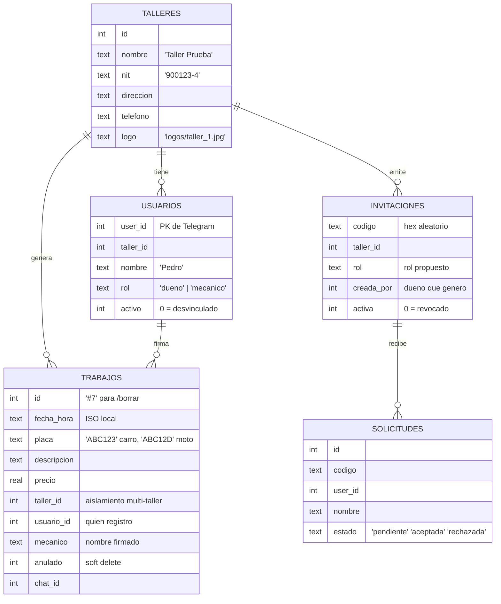

# 🛠️ TallerBot

Bot de Telegram para talleres de mecánica: los mecánicos registran sus trabajos mandando un mensaje corto, el dueño consulta ganancias e historiales y de vez en cuando genera una factura PDF para el cliente. MULTI-TALLER: muchos talleres pueden convivir en el mismo bot, cada uno con su staff y sus datos aislados. Todo se hace desde el chat, sin apps ni formularios.

## 🚀 Inicio rápido

```bash
# 1. Instalar dependencias
py -m venv venv
venv\Scripts\python -m pip install -r requirements.txt

# 2. Configurar
#    Copia .env.example como .env y pon tu token (de @BotFather).

# 3. Correr
venv\Scripts\python bot.py

# 4. Dentro de Telegram:
#    /nuevotaller NombreDelTaller  -> te hace dueño de tu taller
#    /invitar mecanico             -> link para el staff

# 5. Probar la construcción
venv\Scripts\python -m pytest tests -v
```

## 🌱 Onboarding (gestión de talleres y personal — todo desde el chat)

| Comando | Qué hace |
|---|---|
| `/nuevotaller Mi Taller` | Crea el taller; quien lo crea queda como dueño |
| `/invitar mecanico` · `/invitar dueno` | Genera un link de invitación `https://t.me/BOT?start=CODIGO` |
| *(candidato abre el link)* | Toca "🤝 Solicitar unirme" → **la solicitud le llega al dueño con botones ✅/❌** |
| `/personal` | Lista el staff con sus IDs |
| `/rol ID mecanico\|dueno` | Cambia el rol de alguien del taller |
| `/expulsar ID` | Desvincula a alguien (borrado lógico: puede volver con otro link) |
| `/revocar CODIGO` | Mata un link que ya no se usa |

Un usuario pertenece a **un solo taller**. Los datos de cada taller están aislados por completo (con tests que lo garantizan).

## 📱 Uso diario

**Registrar un trabajo** — solo manda el mensaje (formato flexible: `$`, `.`, `,`, placa al final, mayúsculas/minúsculas da igual):

```
ABC123 cambio de aceite 45000
```

| Comando | Dueño | Mecánico |
|---|---|---|
| `/historialdia` | Todos los trabajos de hoy + total | Solo los suyos |
| `/ganancias 7` · `/ganancias mes` | Total del taller + desglose por mecánico | Solo sus sumas |
| `/misganancias` | Sus propias cifras | Sus propias cifras |
| `/buscar ABC123` | Historial completo del vehículo | Solo sus registros |
| `/borrar 5` | Cualquier registro | Solo los suyos |
| `/exportar mes` (CSV) | ✅ Solo el dueño | ❌ |
| `/factura ABC123` | Factura PDF del día, todos los trabajos | Factura PDF del día, solo los suyos |
| `/datostaller nombre=... nit=...` | Edita datos del encabezado de factura | ❌ |
| `/logo` *(foto adjunta)* | Sube el logo del PDF | ❌ |
| `/ayuda` | Menú de comandos | Menú de comandos |

## 🧾 Factura simple (PDF)

`/factura ABC123` agrupa los trabajos de **hoy** de esa placa y manda el PDF como documento. Encabezado con logo, nombre, NIT, dirección y teléfono del taller (definidos con `/datostaller` y `/logo`); items con hora y precio; total; firma de quién atendió. Es un **documento no fiscal**: para factura electrónica ante la DIAN se requiere un proveedor autorizado (fuera del alcance actual).

## ⚙️ Configuración (`.env`)

```ini
TELEGRAM_TOKEN=...   # de @BotFather. Es TODO lo que va en el .env del Sprint 6 en adelante
```

Los roles **no** se configuran aquí desde el Sprint 6: se gestionan desde el bot con `/nuevotaller`, `/invitar`, `/personal`, `/rol` y `/expulsar` (la BD es la fuente de verdad). `ADMIN_IDS`/`MECHANICS` solo se leen una vez para migrar instalaciones anteriores a la BD.

## 🗄️ Base de datos — `taller.db` (SQLite, un solo archivo)



Herramientas para abrirla: **DB Browser for SQLite** (gratis). Respaldo: copia el archivo.

## 📂 Estructura del proyecto

```
TallerBot/
├── bot.py       # punto de entrada: comandos, onboarding, roles y respuestas
├── factura.py   # genera el PDF de facturas (probable sin Telegram)
├── parser.py    # interpreta mensajes de registro (placa/trabajo/precio)
├── db.py        # SQLite: talleres, usuarios, invitaciones, trabajos
├── roles.py     # Helpers de perfil/rol leidos de la BD
├── tests/       # 47 tests (parser, BD, aislamiento, acceso, factura, formatos)
├── logos/       # imagenes de logo subidas por los duenos
├── taller.db    # datos (se crea sola; NO se sube a GitHub)
├── .env         # token (NUNCA subir a GitHub)
└── taller-bot.log  # logs rotativos
```

## 🏗️ Arquitectura rápida

`Telegram (long polling)` → `bot.py` valida el perfil (BD) y decide por rol → `parser.py` valida el mensaje → `db.py` guarda/lee (SIEMPRE filtrado por `taller_id`) → `responder()` contesta con HTML enriquecido → para facturas, `factura.py` arma el PDF y se envía como documento.

## 🧰 Tecnologías utilizadas

| Categoría | Tecnología | Para qué |
|---|---|---|
| Lenguaje | **Python 3.14** | Todo el proyecto |
| Framework bot | **python-telegram-bot 22.8** | Conexión con Telegram (long polling, handlers, callbacks, documentos) |
| Base de datos | **SQLite 3** (módulo `sqlite3` de la librería estándar) | Un solo archivo `taller.db`, sin servidor de BD |
| PDF | **fpdf2 2.9** | Facturas simples con logo y datos del taller |
| Configuración | **python-dotenv** | Token en `.env` |
| Testing | **pytest** | 47 tests unitarios y de integración |
| Control de versiones | **Git + GitHub** | Historial del código |
| Producto | **Telegram Bot API** | La "interfaz" con la que trabajan los mecánicos (0 costo) |

## 🧠 Ingeniería de software aplicada

Decisiones y prácticas de este proyecto más allá del código:

- **Separación de responsabilidades ([SoC](https://en.wikipedia.org/wiki/Separation_of_concerns)):** cada módulo hace una sola cosa (parser ≠ base de datos ≠ roles ≠ facturas ≠ respuestas). Cambiar el formato de los mensajes NO toca SQL, y el PDF se puede probar sin Telegram.
- **Control de acceso en profundidad (defensa en capas):** primero el decorador `protegido` (perfil del usuario en la BD), después reglas por rol dentro de cada comando, y los callbacks (`/borrar`, invitaciones) re-verifican contra la BD. Tres capas, no una.
- **Aislamiento de datos multi-tenant:** TODAS las consultas de trabajos llevan `taller_id`; hay tests que garantizan que un taller jamás vea datos de otro.
- **Borrado lógico (soft delete):** ningún registro ni usuario se destruye; `/borrar` marca `anulado=1` y `/expulsar` marca `activo=0`. Trazabilidad para auditorías y errores humanos.
- **Migraciones simples idempotentes:** `db.init_db()` crea tablas y agrega columnas con `ALTER TABLE` silencioso, pero SEGMENTADO POR TABLA (lección aprendida: una migración mal enfocada corrompe el esquema).
- **Fail-safe en superficie:** `error_global` captura toda excepción, loguea y responde algo amable — *ningún handler tumba al bot*. Nunca silencio: hasta los comandos mal escritos (`/ganancias` sin `s`) tienen alias y un fallback.
- **Configuración fuera del código (12-factor "config"):** el `.env` solo lleva secretos; personas y talleres se manage desde el propio producto. Escalar la operación no toca una línea de código ni requiere redeploy.
- **Un solo canal de respuestas:** toda salida pasa por `responder()` con `parse_mode="HTML"` — imposible que un mensaje nuevo repita el bug del `<b>` literal.
- **Testing primero donde importa:** el parser (la parte que usan manos ocupadas), el onboarding y las reglas de visibilidad por rol tienen cobertura de tests; la BD se prueba con archivos temporales `tmp_path` para no tocar datos reales.
- **Git con disciplina:** commits por sprint con tickets (S6-3, S7-2…), `.gitignore` excluyendo secretos (`.env`), datos (`*.db`, `*.log`) y artefactos generados (`logos/`, `muestra_*.pdf`).

## 📖 Sprints del proyecto

0. ✅ Esqueleto y setup · 1. ✅ Registro de trabajos · 2. ✅ Comandos de consulta · 3. ✅ Seguridad (lista blanca + logs) · 5. ✅ Roles dueño/mecánico + firma · 6. ✅ Multi-tenant (talleres, invitaciones, onboarding) · 7. ✅ Factura PDF con datos del taller · 4. ⬜ Nube gratuita (despliegue 24/7)
