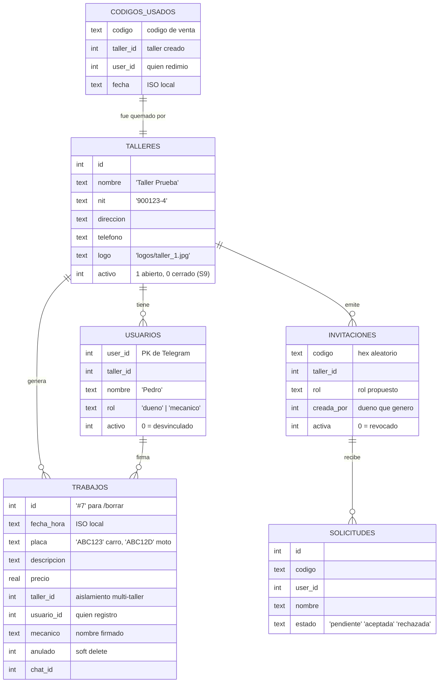

# 🛠️ TallerBot

Bot de Telegram para talleres de mecánica: los mecánicos registran sus trabajos mandando un mensaje corto, el dueño consulta ganancias e historiales y de vez en cuando genera una factura PDF para el cliente. MULTI-TALLER: muchos talleres pueden convivir en el mismo bot, cada uno con su staff y sus datos aislados. Todo se hace desde el chat, sin apps ni formularios.

## 🚀 Inicio rápido

```bash
# 1. Instalar dependencias
py -m venv venv
venv\Scripts\python -m pip install -r requirements.txt

# 2. Configurar
#    Copia .env.example como .env y pon tu token (de @BotFather).

# 3. Correr
venv\Scripts\python bot.py

# 4. Dentro de Telegram:
#    /nuevotaller CODIGO NombreDelTaller  -> requiere un código de venta
#    (el desarrollador lo pone en CODIGOS_TALLER del .env)
#    /invitar mecanico                    -> link para el staff

# 5. Probar la construcción
venv\Scripts\python -m pytest tests -v
```

## 🌱 Onboarding (gestión de talleres y personal — todo desde el chat)

| Comando | Qué hace |
|---|---|
| `/nuevotaller CODIGO Mi Taller` | Crea el taller y el creador queda como dueño. **Requiere un código de venta de un solo uso** (lo emite el desarrollador) |
| `/invitar mecanico` · `/invitar dueno` | Genera un link de invitación `https://t.me/BOT?start=CODIGO` |
| *(candidato abre el link)* | Toca "🤝 Solicitar unirme" → **la solicitud le llega al dueño con botones ✅/❌** |
| `/personal` | Lista el staff con sus IDs |
| `/rol ID mecanico\|dueno` | Cambia el rol de alguien del taller |
| `/expulsar ID` | Desvincula a alguien (borrado lógico: puede volver con otro link) |
| `/revocar CODIGO` | Mata un link que ya no se usa |
| `/cerrartaller` | **Dueño cierra SU taller** (con botón de confirmación): nadie entra, invitaciones revocadas, datos quedan guardados |
| `/talleres` *(desarrollador)* | Lista TODOS los talleres: id, estado (activo/cerrado), staff y trabajos |

Un usuario pertenece a **un solo taller**. Los datos de cada taller están aislados por completo (con tests que lo garantizan).

## 📱 Uso diario

**Registrar un trabajo** — solo manda el mensaje (formato flexible: `$`, `.`, `,`, placa al final, mayúsculas/minúsculas da igual):

```
ABC123 cambio de aceite 45000
```

| Comando | Dueño | Mecánico |
|---|---|---|
| `/historialdia` | Todos los trabajos de hoy + total | Solo los suyos |
| `/ganancias 7` · `/ganancias mes` | Total del taller + desglose por mecánico | Solo sus sumas |
| `/misganancias` | Sus propias cifras | Sus propias cifras |
| `/buscar ABC123` | Historial completo del vehículo | Solo sus registros |
| `/borrar 5` | Cualquier registro | Solo los suyos |
| `/exportar mes` (CSV) | ✅ Solo el dueño | ❌ |
| `/factura ABC123` | Factura PDF del día, todos los trabajos | Factura PDF del día, solo los suyos |
| `/datostaller nombre=... nit=...` | Edita datos del encabezado de factura | ❌ |
| `/logo` *(foto adjunta)* | Sube el logo del PDF | ❌ |
| `/ayuda` | Menú de comandos | Menú de comandos |

## 🧾 Factura simple (PDF)

`/factura ABC123` agrupa los trabajos de **hoy** de esa placa y manda el PDF como documento. Encabezado con logo, nombre, NIT, dirección y teléfono del taller (definidos con `/datostaller` y `/logo`); items con hora y precio; total; firma de quién atendió. Es un **documento no fiscal**: para factura electrónica ante la DIAN se requiere un proveedor autorizado (fuera del alcance actual).

### 🏢 Identidad del taller: los datos que van en la factura

Todo taller debe dejar su membrete una sola vez. Lo administra el **dueño**, desde el mismo chat del bot:

| Acción | Comando | Ejemplo |
|---|---|---|
| Nombre del taller | `/datostaller nombre=...` | `/datostaller nombre=Taller Los Pistones` |
| NIT | `/datostaller nit=...` | `/datostaller nit=900.123.456-7` |
| Teléfono | `/datostaller tel=...` | `/datostaller tel=+57 300 111 2233` |
| Dirección | `/datostaller dir=...` | `/datostaller dir=Calle 45 #12-30, Medellín` |
| Varios a la vez | `claves=valor` separadas por espacio | `/datostaller nit=900123-4 tel=3001112233 dir=Cra 10 #20-30` |
| Ver qué hay y qué falta | `/datostaller` (sin nada) | lista el estado actual |
| Logo (imagen) | foto adjunta + `/logo` en la caption | 🖼️ queda como `logos/taller_N.jpg` |

Detalles del diseño, por qué es cómodo de usar:

- **Los valores admiten espacios**: todo lo que sigue a una clave hasta la próxima `clave=` se une como valor (`dir=Calle 45 #12-30` funciona sin comillas).
- **`tel` y `dir` son alias cortos** de `telefono` y `direccion` — las manos no escriben de sobra.
- **`/datostaller nombre=...` también renombra el taller** en todo el bot (el título de tus reportes ya no dice "Taller Prueba" sino tu marca real).
- El cambio es **inmediato**: la próxima `/factura` ya sale con el nuevo membrete, sin reiniciar nada.
- El logo se guarda en `logos/` bajo el ID del taller (aislamiento multi-taller también aquí), y si la imagen viniera corrupta, la factura sale igual — sin logo, sin caída.

Así se ve el encabezado de un PDF recién emitido (con el logo en la esquina):

```
┌─────────────────────────────────────────────────────────┐
│ [LOGO]  TALLER LOS PISTONES                             │
│         NIT: 900.123.456-7 · Tel: 3001112233            │
│         Cra 10 #20-30, Medellín                         │
│ ─────────────────────────────────────────────────────── │
│           FACTURA SIMPLE (NO FISCAL)                    │
│  Comprobante de pago: 07/11/2026        Placa: ABC123   │
│  Hora         Trabajo                      Valor        │
│  09:15 am     cambio de aceite             $ 45.000     │
│  11:44 am     pastillas de freno           $ 120.000    │
│                             TOTAL:          $ 165.000   │
│         Cobrado y atendido por: Pedro                   │
│        Documento no fiscal generado por TallerBot.      │
└─────────────────────────────────────────────────────────┘
```

## ⚙️ Configuración (`.env`)

```ini
TELEGRAM_TOKEN=...            # de @BotFather
CODIGOS_TALLER=VENTA-PEDRO-2026-A1,VENTA-MARIA-0002   # códigos de venta (S8)
DESARROLLO_ID=9136002456      # tu ID de Telegram: comando /talleres (S9) (opcional)
TZ=America/Bogota             # hora del taller si corre en la nube (Render/VM)
```

Los roles **no** se configuran aquí desde el Sprint 6: se gestionan desde el bot con `/nuevotaller`, `/invitar`, `/personal`, `/rol` y `/expulsar` (la BD es la fuente de verdad). `ADMIN_IDS`/`MECHANICS` solo se leen una vez para migrar instalaciones anteriores a la BD.

## 💰 Modalidad comercial (códigos de venta, Sprint 8)

Nadie puede crear un taller gratis: **se necesita un código que emite el desarrollador**.

1. Vendes el bot → agregas un código nuevo a `CODIGOS_TALLER` → reinicias:
   - **Corriendo en Render**: es la pestaña *Environment* del dashboard (editás la variable, **Save** y el redeploy sale solito).
   - **Corriendo local** (tu PC): editas el `.env` y vuelves a arrancar el bot.
2. Le pasas el código al comprador junto con el link del bot.
3. El comprador manda: `/nuevotaller VENTA-PEDRO-2026-A1 Taller Pedro Motores` → queda como dueño de su taller.
4. **El código se quema al usarse**: la marca de "ya redimido" vive en la BD (`codigos_usados`: código, taller, quién, cuándo) — sobrevive a reinicios y no es inventable reenviando el link.
5. Los mecánicos/dueños adicionales NO necesitan código: el dueño de cada taller ya los invita con los links normales.

Es decir: como desarrollador, tu operación de venta entera es "agregar una palabra en `CODIGOS_TALLER`". Catálogo en el Environment/`.env`, estado de uso en la BD.

## 🗄️ Base de datos — `taller.db` (SQLite, un solo archivo)



Herramientas para abrirla: **DB Browser for SQLite** (gratis, solo lectura de la BD). Respaldo local: copia el archivo. **En la nube** la BD viva está dentro del contenedor de Render (sin SSH en el plan free), pero el repo de respaldo (`respaldo/taller.db`, commit cada ~10 min) sirve de copia consultable: `git pull` en tu clone y abralo en DB Browser — mira el paso a paso en [DEPLOY.md](DEPLOY.md).

## 📂 Estructura del proyecto

```
TallerBot/
├── bot.py       # punto de entrada: comandos, onboarding, roles y respuestas
├── factura.py   # genera el PDF de facturas (probable sin Telegram)
├── parser.py    # interpreta mensajes de registro (placa/trabajo/precio)
├── db.py        # SQLite: talleres, usuarios, invitaciones, trabajos
├── respaldo.py  # BD <-> repo privado de GitHub (Render free no tiene disco)
├── roles.py     # Helpers de perfil/rol leidos de la BD
├── render.yaml  # blueprint de deployment en Render (mira DEPLOY.md)
├── tests/       # 73 tests (parser, BD, aislamiento, acceso, factura, códigos, respaldos, formatos)
├── logos/       # imagenes de logo subidas por los duenos
├── taller.db    # datos (se crea sola; NO se sube a GitHub)
├── .env         # token (NUNCA subir a GitHub)
└── taller-bot.log  # logs rotativos
```

## 🏗️ Arquitectura rápida

`Telegram (long polling)` → `bot.py` valida el perfil (BD) y decide por rol → `parser.py` valida el mensaje → `db.py` guarda/lee (SIEMPRE filtrado por `taller_id`) → `responder()` contesta con HTML enriquecido → para facturas, `factura.py` arma el PDF y se envía como documento.

## ☁️ Despliegue 24/7 (Render free, $0)

El bot corre gratis y siempre encendido en Render, con dos parches de ingeniería para las
limitaciones del plan free:

- **La BD se respalda sola en un repo privado de GitHub** (`respaldo.py`): sube `taller.db`
  vía API cada `RESPALDO_MINUTOS` (10 por defecto) y la restaura al arrancar si falta.
  Fail-safe total: si falta el token o la red cae, el bot sigue andando.
- **Servidor de salud integrado**: si la nube define `PORT`, el bot abre un mini-HTTP con
  `/salud` en un hilo aparte (en tu PC no cambia nada).
- **Pinger externo** (cron-job.org) despierta/consulta `/salud` cada 10 min → nunca duerme.

Guía completa paso a paso (repo de respaldo, token, variables, migrar tu BD y pilotaje de 48 h)
en **[DEPLOY.md](DEPLOY.md)**.

💡 Un solo detalle operativo: solo un proceso puede usar el token de Telegram a la vez.
O sea, cuando Render tome el turno, **apaga el bot de tu PC** (o habrá conflicto).

## 🧰 Tecnologías utilizadas

| Categoría | Tecnología | Para qué |
|---|---|---|
| Lenguaje | **Python 3.14** | Todo el proyecto |
| Framework bot | **python-telegram-bot 22.8** | Conexión con Telegram (long polling, handlers, callbacks, documentos) |
| Base de datos | **SQLite 3** (módulo `sqlite3` de la librería estándar) | Un solo archivo `taller.db`, sin servidor de BD |
| PDF | **fpdf2 2.9** | Facturas simples con logo y datos del taller |
| Configuración | **python-dotenv** | Token en `.env` |
| Testing | **pytest** | 73 tests unitarios y de integración |
| Control de versiones | **Git + GitHub** | Historial del código |
| Infraestructura | **Render (plano free) + cron-job.org** | Hosting 24/7 respaldado con la API de contenidos de GitHub |
| Producto | **Telegram Bot API** | La "interfaz" con la que trabajan los mecánicos (0 costo) |

## 🧠 Ingeniería de software aplicada

Decisiones y prácticas de este proyecto más allá del código:

- **Separación de responsabilidades ([SoC](https://en.wikipedia.org/wiki/Separation_of_concerns)):** cada módulo hace una sola cosa (parser ≠ base de datos ≠ roles ≠ facturas ≠ respuestas). Cambiar el formato de los mensajes NO toca SQL, y el PDF se puede probar sin Telegram.
- **Control de acceso en profundidad (defensa en capas):** primero el decorador `protegido` (perfil del usuario en la BD), después reglas por rol dentro de cada comando, y los callbacks (`/borrar`, invitaciones) re-verifican contra la BD. Tres capas, no una.
- **Aislamiento de datos multi-tenant:** TODAS las consultas de trabajos llevan `taller_id`; hay tests que garantizan que un taller jamás vea datos de otro.
- **Códigos de venta = catálogo ≠ estado (S8):** el catálogo de códigos vive en el `.env` (solo editable por el desarrollador) pero el registro de "cuál ya se usó" vive en la BD con redención Atómica (`INSERT OR IGNORE`). Un código es de un solo uso aunque salte reinicios del servidor.
- **Borrado lógico (soft delete):** ningún registro, usuario ni taller se destruye; `/borrar` marca `anulado=1`, `/expulsar` y `/cerrartaller` marcan `activo=0`. Trazabilidad para auditorías y errores humanos; la reapertura de un taller cerrado la hace el desarrollador.
- **Migraciones simples idempotentes:** `db.init_db()` crea tablas y agrega columnas con `ALTER TABLE` silencioso, pero SEGMENTADO POR TABLA (lección aprendida: una migración mal enfocada corrompe el esquema).
- **Fail-safe en superficie:** `error_global` captura toda excepción, loguea y responde algo amable — *ningún handler tumba al bot*. Nunca silencio: hasta los comandos mal escritos (`/ganancias` sin `s`) tienen alias y un fallback.
- **Configuración fuera del código (12-factor "config"):** el `.env` solo lleva secretos; personas y talleres se manejan desde el propio producto. Escalar la operación no toca una línea de código ni requiere redeploy.
- **Un solo canal de respuestas:** toda salida pasa por `responder()` con `parse_mode="HTML"` — imposible que un mensaje nuevo repita el bug del `<b>` literal.
- **Testing primero donde importa:** el parser (la parte que usan manos ocupadas), el onboarding y las reglas de visibilidad por rol tienen cobertura de tests; la BD se prueba con archivos temporales `tmp_path` para no tocar datos reales.
- **Git con disciplina:** commits por sprint con tickets (S6-3, S7-2…), `.gitignore` excluyendo secretos (`.env`), datos (`*.db`, `*.log`) y artefactos generados (`logos/`, `muestra_*.pdf`).

## 📖 Sprints del proyecto

0. ✅ Esqueleto y setup · 1. ✅ Registro de trabajos · 2. ✅ Comandos de consulta · 3. ✅ Seguridad (lista blanca + logs) · 5. ✅ Roles dueño/mecánico + firma · 6. ✅ Multi-tenant (talleres, invitaciones, onboarding) · 7. ✅ Factura PDF con datos del taller · 8. ✅ Códigos de venta (modalidad comercial) · 4. ✅ Nube gratuita (Render free, 24/7 con respaldos a GitHub — guía completa en [DEPLOY.md](DEPLOY.md)) · 9. ✅ Cierre de talleres (/cerrartaller + /talleres de desarrollador)
